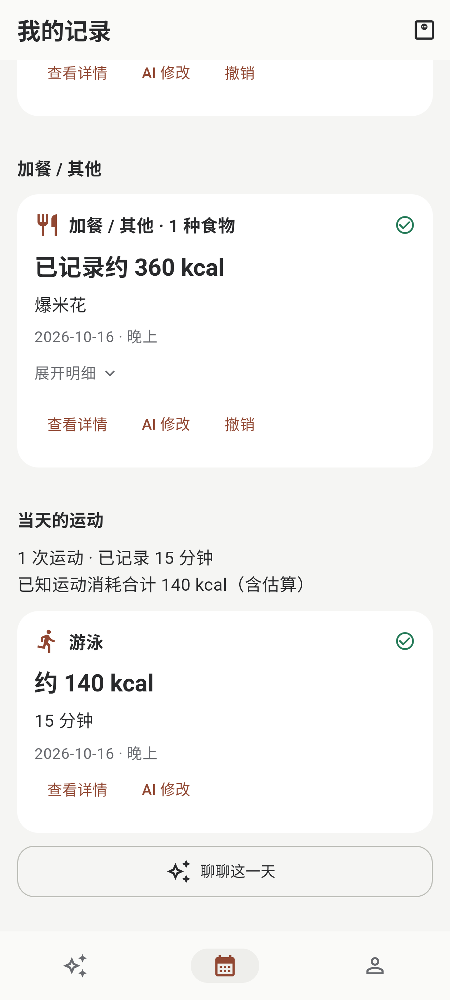
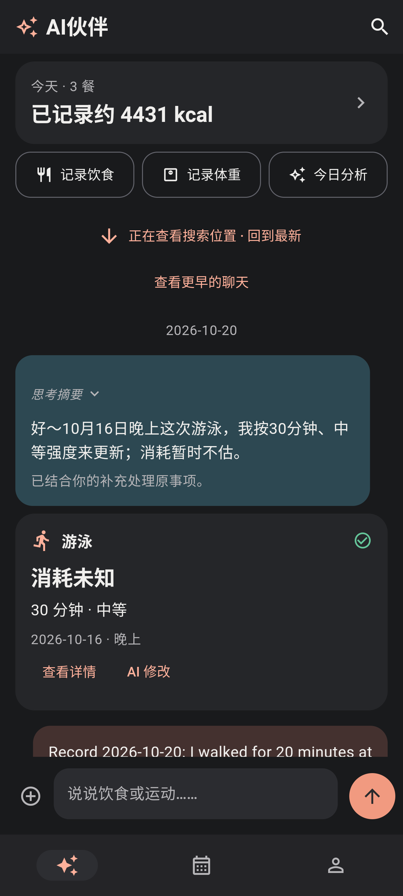
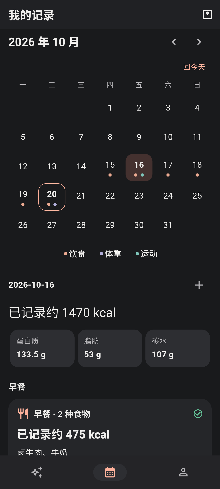
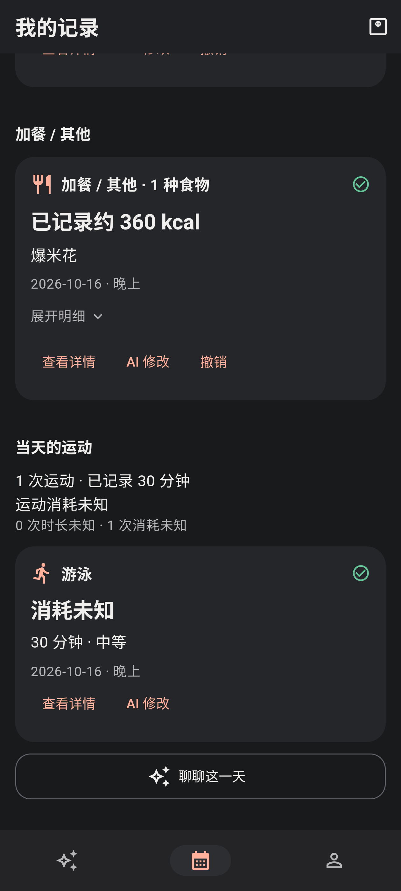

  

<h1 align="center">食记</h1>

随手说说吃了什么、做了什么运动，留下自己的日常记录。

<strong>Android · Flutter · 本地保存 · 自选 AI 接口</strong>

  <a href="#界面一览">界面一览</a> ·
  <a href="https://github.com/KazeLiu/food-journal-app/releases/tag/v0.1.23">下载正式版</a> ·
  <a href="#开始使用">开始使用</a> ·
  <a href="app/README.md">构建工程</a> ·
  <a href="#开发文档">开发文档</a>

用文字或照片描述饮食，也能在同一条消息里说说运动。饮食、运动与体重分别保存，可离线手动记录；没有热量目标、剩余额度或打卡压力，详细信息在需要时展开。

## 界面一览

<table>
  <tr>
    <td align="center" width="33%"><strong>AI 伙伴</strong></td>
    <td align="center" width="33%"><strong>每日记录</strong></td>
    <td align="center" width="33%"><strong>运动记录</strong></td>
  </tr>
  <tr>
    <td align="center"></td>
    <td align="center"></td>
    <td align="center"></td>
  </tr>
  <tr>
    <td align="center">自然回复与更新后的记录卡并存</td>
    <td align="center">按日期回看饮食、运动和体重</td>
    <td align="center">主动估算消耗，与饮食分别汇总</td>
  </tr>
  <tr>
    <td align="center"></td>
    <td align="center"></td>
    <td align="center"></td>
  </tr>
</table>

截图来自 MuMu 实际界面，上排浅色、下排深色；首页已更新为 0.1.21 紧凑布局，记录页沿用 0.1.20。10 月 16 日为混合饮食与运动的联调示例，游泳已按范围取中值估算。点击图片可查看原图。

## 可以做什么

- **文字与照片记录**：单条最多3张图，发送后保留缩略图，可点击放大；上传百分比与识别等待分开显示。
- **可纠正的记录卡**：原回复不被卡片覆盖，一餐多个食物；支持聊天纠正、直接编辑、逐项撤销和搜索定位。
- **自己的食品资料库**：拍包装、营养表或配料表填写草稿；结合含义、做法和相关对话找候选，同款按库换算，相近食品只作 AI 参考，不反复要求选择商品。
- **轻量日常入口**：今日概览与等高的“今日分析”并排固定顶部，日历回看历史；体重同日多次独立保存，支持斤 / 公斤。
- **桌面快捷入口**：长按“食记”图标，选择“记录体重”或“快速拍照录入”；拍照后回到聊天草稿并聚焦输入框，补充文字后自己发送。
- **饮食与运动一起说**：分别保存；运动可先记名称，再补时长。消耗独立汇总，不与饮食抵扣。
- **统一新主题**：暖中性浅色与石墨深色共用柔和珊瑚橘，支持跟随系统。
- **保留思考与失败恢复**：接口返回的思考可折叠查看；失败项可重试或手动处理，成功项不重复保存。
- **数据自己保管**：SQLite本地记录，无账号或自有服务器；支持CSV、完整备份和可选密码，不做云同步。

## 开始使用

1. 下载 [食记 0.1.23 正式版](https://github.com/KazeLiu/food-journal-app/releases/tag/v0.1.23)，或按 [Android 工程说明](app/README.md#构建)自行构建；无 API 也可手动记录。已有同发布签名的 0.1.20 / 0.1.22 release 包可覆盖升级；debug 包需先完整备份再换装，不能跨签名覆盖，见[换装说明](docs/releases/v0.1.22.md#从-debug-包换装前先备份)。
2. 使用 AI 时，在“我的 → AI 接口与模型”填写 Base URL、Key 和文字主模型。服务需支持 **Responses API**；图片主模型按需配置，两个备用模型可留空，各模型可单独选择思考强度。
3. 在 AI伙伴发消息，或进入“食品资料库 → 添加食品资料 → AI 拍照识别”。后者只填写表单，不创建已吃记录，需自行点击保存。

在支持 Android 应用快捷方式的桌面，也可长按“食记”图标进入体重表单或直接拍照。快速拍照保留已有聊天草稿，不自动发送、识别或保存饮食；一条消息仍最多3张图片。首次使用仍先完成或跳过本地引导。

主模型失败会原模型重试一次，仍失败才使用已配置的备用；备用失败也重试一次，成功即停止。见 [请求阶段与主备](docs/04-ai-contract.md#3-请求阶段与主备)。

Key只保存在设备安全存储。使用AI时，会向你配置的服务发送当前任务需要的文字和图片；业务备份不含Key、AI连接配置或图片预览。删除聊天会清理其压缩预览，不删除相册原图，也不删除已有饮食记录。

## 开发文档

Flutter Android 源码位于 [app/](app/README.md)，当前源码版本 **0.1.23+24**，项目与软件展示名称为“食记”；包名、数据和发布签名不变。此版修复食品资料导致聊天失败、跨日期餐数少算、编辑记录意外改写时间戳和图片恢复阻断启动的问题，详见 [0.1.23 发布说明](docs/releases/v0.1.23.md)。构建、安装和实际验收范围见 [10 实现状态](docs/10-implementation-status.md)。

| 文档 | 内容 |
| --- | --- |
| [01 产品规格](docs/01-product-spec.md) | 完整范围、记录语义、营养来源与用户控制 |
| [02 页面与交互](docs/02-ui-and-flows.md) | 页面、子流程、反馈状态及视觉规范 |
| [03 架构与数据](docs/03-architecture-and-data.md) | Flutter 职责、SQLite 表结构、汇总与版本 |
| [04 AI 接口与数据契约](docs/04-ai-contract.md) | Responses、流式、识图、历史查询和操作格式 |
| [05 可靠性与数据安全](docs/05-reliability-and-data-safety.md) | 排队、部分成功、撤销、补算、图片与恢复 |
| [06 开发计划与验收](docs/06-development-plan-and-acceptance.md) | 阶段、依赖、需求追踪和用户验收场景 |
| [07 参考资料与实现边界](docs/07-references.md) | 官方资料、第三方兼容边界和环境记录 |
| [08 分享设计与界面参考](docs/08-shared-design-review.md) | 设计来源、组件清单和可复用界面代码 |
| [09 决策记录](docs/09-decisions-to-confirm.md) | 已确认选择、运动记录方向与待确认细节 |
| [10 实现状态](docs/10-implementation-status.md) | 源码落点、工具链、编译证据与验收范围 |
| [11 主题视觉规范](docs/11-theme-design.md) | 石墨黑与柔和珊瑚橘、浅深主题、Flutter 令牌及实施验收 |

D01、D02、D03 均已确认 A：保留直接编辑、长按引用不加右滑、图片识别后交文字模型处理。

## 运动记录

同一条 AI 对话可混合描述饮食和运动，分别保存，在“我的记录”按日期查看。只说“游了个泳”也能先记下，时长与消耗留空；稍后回答问题时更新原记录，不再新增一次。

运动支持手动新增、编辑、聊天纠正、查询、删除撤销、独立汇总与 CSV / 完整备份恢复。有运动类型和时长，AI 就按合理范围取中值，标明“约”并保留假设，不要求准确卡路里、泳姿、强度或体重；用户明确提供的消耗仍优先。运动不算负热量食物，不自动计算热量缺口。

“我的 → 估算参考”可选填写身高和性别，填写后随对话作为运动估算参考，允许清空；完整备份会保留。食物热量不因个人资料改变，修改资料不自动重算历史运动。

主对话上下文另按 D09 调整设计：默认提供当天全部记录，指定日期或比较时使用涉及日期；调用策略建议复用现有按需查询，见 [04 的按日上下文调整](docs/04-ai-contract.md#按日上下文调整d09待开发)。当前代码尚未改为此规则。

## 统一主题

旧浅色与深色配色已由“现代科技感 × 石墨黑 × 柔和珊瑚橘”直接替换，不保留旧主题选项。跟随系统 / 浅色 / 深色仍是现有三个外观模式，沿用 Flutter 原生主题和原有设置持久化；运动卡片、表单与日历标记一并适配。颜色与组件要求见 [11 主题视觉规范](docs/11-theme-design.md)。“餐盘 + 相机取景框”的[透明底图标](docs/assets/app-icon-transparent-v2.png) 保持不变。

## 实现约定

数据结构以 03 为准，AI 格式以 04 为准，状态和恢复以 05 为准。08 追溯参考设计，09 保留产品决策，10 记录实际交付和设备证据，11 统一维护主题视觉规范。

构建方法见 [app/README.md](app/README.md)。发布密钥及配置仅保存在本机私有目录，不随源码或发行附件提供；后续 release 沿用同一签名。

开发者默认通过阅读代码、核对调用关系和差异自查；06 的场景是验收定义，不是已执行结果。

## 感谢

感谢 [LINUX DO 社区](https://linux.do/)。
