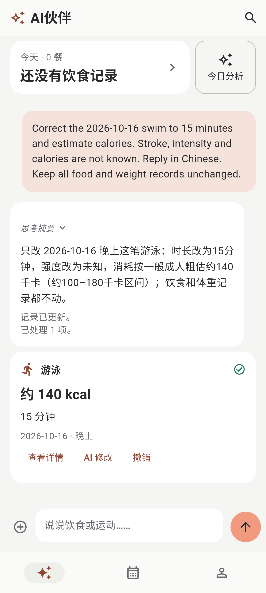
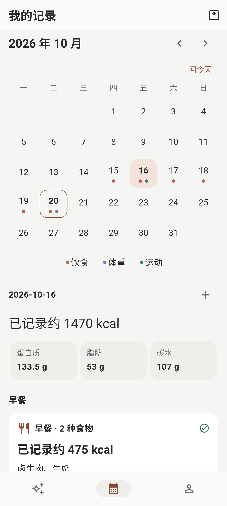
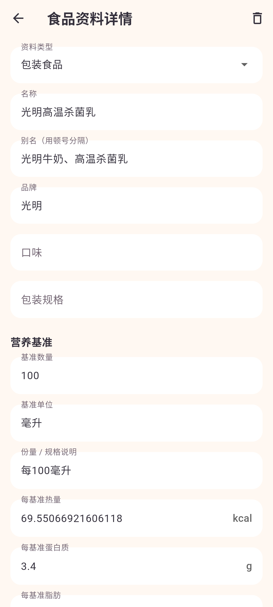

  

<h1 align="center">AI 减脂伙伴</h1>

随手说说吃了什么，留下自己的饮食与体重记录。

<strong>Android · Flutter · 本地保存 · 自选 AI 接口</strong>

  <a href="#界面一览">界面一览</a> ·
  <a href="#开始使用">开始使用</a> ·
  <a href="app/README.md">构建工程</a> ·
  <a href="#开发文档">开发文档</a>

用文字或照片描述一餐，AI 估算热量和营养，保存后生成记录卡；也可以离线手动记录饮食和体重。没有热量目标、剩余额度或打卡压力，详细信息在需要时展开。

## 界面一览

<table>
  <tr>
    <td align="center" width="33%"><strong>AI 伙伴</strong></td>
    <td align="center" width="33%"><strong>每日记录</strong></td>
    <td align="center" width="33%"><strong>食品资料</strong></td>
  </tr>
  <tr>
    <td align="center"></td>
    <td align="center"></td>
    <td align="center"></td>
  </tr>
  <tr>
    <td align="center">搜索定位，回复与记录卡并存</td>
    <td align="center">按日期回看饮食和体重</td>
    <td align="center">拍照填表，核对后人工保存</td>
  </tr>
</table>

截图来自 0.1.16 的 MuMu 实际界面，展示试用示例数据；点击图片可查看原图。

## 可以做什么

- **文字与照片记录**：单条最多3张图，发送后保留缩略图，可点击放大；上传百分比与识别等待分开显示。
- **可纠正的记录卡**：原回复不被卡片覆盖，一餐多个食物；支持聊天纠正、直接编辑、逐项撤销和搜索定位。
- **自己的食品资料库**：拍包装、营养表或配料表填写草稿，AI可联想常用别名；核对并保存后，后续记录按资料库原值换算。
- **轻量日常入口**：今日概览固定顶部，日历回看历史；体重同日多次独立保存，支持斤 / 公斤。
- **保留思考与失败恢复**：接口返回的思考可折叠查看；失败项可重试或手动处理，成功项不重复保存。
- **数据自己保管**：SQLite本地记录，无账号或自有服务器；支持CSV、完整备份和可选密码，不做云同步。

## 开始使用

1. 按 [Android 工程说明](app/README.md#构建)构建并安装 debug APK；无 API 也可手动记录。
2. 使用 AI 时，在“我的 → AI 接口与模型”填写 Base URL、Key 和文字主模型。服务需支持 **Responses API**；图片主模型按需配置，两个备用模型可留空，各模型可单独选择思考强度。
3. 在 AI伙伴发消息，或进入“食品资料库 → 添加食品资料 → AI 拍照识别”。后者只填写表单，不创建已吃记录，需自行点击保存。

主模型失败会原模型重试一次，仍失败才使用已配置的备用；备用失败也重试一次，成功即停止。见 [请求阶段与主备](docs/04-ai-contract.md#3-请求阶段与主备)。

Key只保存在设备安全存储。使用AI时，会向你配置的服务发送当前任务需要的文字和图片；业务备份不含Key、AI连接配置或图片预览。删除聊天会清理其压缩预览，不删除相册原图，也不删除已有饮食记录。

## 开发文档

Flutter Android 源码位于 [app/](app/README.md)，当前版本 **0.1.17+18**。构建、安装和实际验收范围见 [10 实现状态](docs/10-implementation-status.md)；当前包使用开发调试签名，正式发布需要独立签名。

| 文档 | 内容 |
| --- | --- |
| [01 产品规格](docs/01-product-spec.md) | 完整范围、记录语义、营养来源与用户控制 |
| [02 页面与交互](docs/02-ui-and-flows.md) | 页面、子流程、反馈状态及视觉规范 |
| [03 架构与数据](docs/03-architecture-and-data.md) | Flutter 职责、SQLite 表结构、汇总与版本 |
| [04 AI 接口与数据契约](docs/04-ai-contract.md) | Responses、流式、识图、历史查询和操作格式 |
| [05 可靠性与数据安全](docs/05-reliability-and-data-safety.md) | 排队、部分成功、撤销、补算、图片与恢复 |
| [06 开发计划与验收](docs/06-development-plan-and-acceptance.md) | 阶段、依赖、需求追踪和用户验收场景 |
| [07 参考资料与实现边界](docs/07-references.md) | 官方资料、第三方兼容边界和环境记录 |
| [08 分享设计与界面参考](docs/08-shared-design-review.md) | 设计来源、组件清单和可复用界面代码 |
| [09 决策记录](docs/09-decisions-to-confirm.md) | 已确认选择、运动记录方向与待确认细节 |
| [10 实现状态](docs/10-implementation-status.md) | 源码落点、工具链、编译证据与验收范围 |
| [11 主题视觉规范](docs/11-theme-design.md) | 石墨黑与柔和珊瑚橘、浅深主题、Flutter 令牌及实施验收 |

D01、D02、D03 均已确认 A：保留直接编辑、长按引用不加右滑、图片识别后交文字模型处理。

## 运动记录扩展（设计中）

新增需求 R17：同一条 AI 对话可混合描述饮食和运动，运动也在“我的记录”查看，沿用现有三个底部入口。细节确认后再开发，当前源码和 APK 不包含该扩展。

用户示例和产品范围见 [01 的运动记录扩展](docs/01-product-spec.md#11-运动记录扩展设计中)。缺少时长的处理、消耗估算和页面展示仍待确认，建议集中在 [09 决策记录](docs/09-decisions-to-confirm.md#运动记录扩展r17)。

主对话上下文另按 D09 调整设计：默认提供当天全部记录，指定日期或比较时使用涉及日期；调用策略建议复用现有按需查询，见 [04 的按日上下文调整](docs/04-ai-contract.md#按日上下文调整d09待开发)。当前代码尚未改为此规则。

## 主题视觉升级（待实施）

主题视觉升级按 [11 主题视觉规范](docs/11-theme-design.md)：同时优化浅色与深色，沿用 Flutter 原生主题和现有设置持久化，保留业务功能与布局。主题规范待实施；“餐盘 + 相机取景框”的[透明底图标](docs/assets/app-icon-transparent-v2.png) 已接入 Android 多密度与自适应资源，手机实际显示由用户安装后验收。

## 实现约定

数据结构以 03 为准，AI 格式以 04 为准，状态和恢复以 05 为准。08 用于追溯参考设计，09 保留产品决策和运动扩展待确认项，10 记录实际交付状态，11 统一维护主题视觉规范。各文档中的运动扩展草案不改变当前数据库、协议或 APK 的能力。

构建方法见 [app/README.md](app/README.md)。当前包为开发调试签名，正式发布需要单独配置并保管签名。

开发者默认通过阅读代码、核对调用关系和差异自查；06 的场景是验收定义，不是已执行结果。
